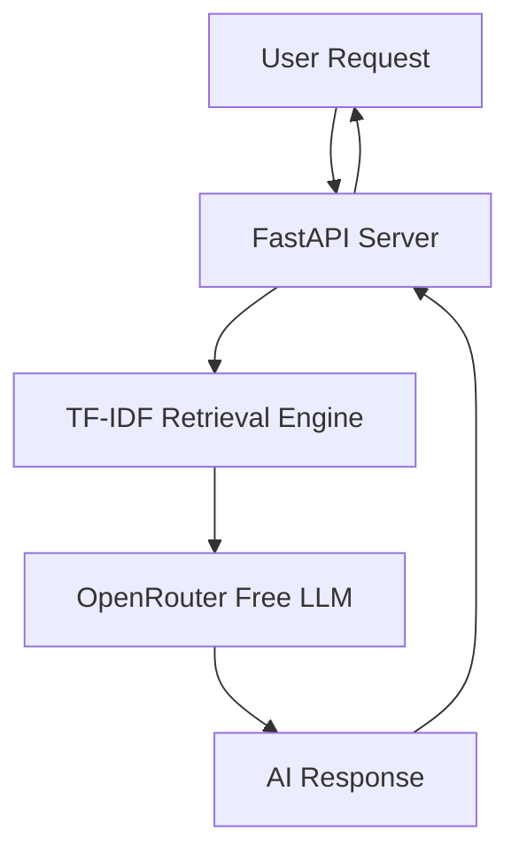

# DarGlobal & Wasalt AI Chatbot


A lightweight, **retrieval‑augmented generation** (RAG) chatbot that answers property‑related questions about **DarGlobal** and **Wasalt**. The assistant scrapes publicly available data, builds a TF‑IDF knowledge base, and queries a free LLM via **OpenRouter**. It runs in a minimal Docker container and can be deployed to Render.com with a single click.

---

## 🚀 Live Demo

**URL:** https://chatbot-or3g.onrender.com/

---

## ✨ Features

- **Automated web scraping** – pulls up‑to‑date information from `darglobal.co.uk` and `wasalt.com`.
- **RAG with TF‑IDF** – fast, deterministic retrieval of the most relevant text chunks.
- **Free LLM integration** – uses OpenRouter’s free‑tier models (e.g., Llama‑3.1‑8B, Gemma‑2‑9B).
- **Dockerised** – multi‑stage Dockerfile for a clean production image.
- **Conversation memory** – retains session history for multi‑turn interactions.
- **REST API** – easy programmatic access (`/api/chat`, `/api/clear`, `/api/health`).
- **Render deployment** – `render.yaml` provides a zero‑configuration, free‑tier deployment.

---

## 📐 Architecture Overview



---

## 📁 Project Structure

```
├── app/
│   ├── main.py          # FastAPI entry point
│   ├── chat.py          # OpenRouter integration
│   └── retrieval.py     # TF‑IDF RAG engine
├── scraper/
│   └── scrape.py        # DarGlobal & Wasalt scraper
├── data/
│   ├── scraped_data.json        # Curated data
│   ├── knowledge_chunks.json    # RAG chunks (auto‑generated)
│   └── raw_scraped.json         # Raw scraper output
├── templates/index.html  # Chat UI
├── static/               # Static assets (CSS/JS)
├── Dockerfile            # Multi‑stage build
├── docker-compose.yml    # Local compose setup
├── render.yaml           # Render.com config
├── requirements.txt      # Python dependencies
└── .env.example          # Env var template
```

---

## 🛠️ Getting Started

### Prerequisites
- **Python 3.12+** (if running without Docker)
- **Docker** & **Docker Compose** (recommended)
- **OpenRouter API key** – obtain one at <https://openrouter.ai/keys>

### 1. Clone & configure
```bash
git clone https://github.com/shreyagaur-10/chatbot_.git
cd chatbot_
cp .env.example .env   # edit .env and add your OPENROUTER_API_KEY
```

### 2. Run locally (Docker – recommended)
```bash
docker compose up --build
```
The service will be reachable at **http://localhost:8000**.

### 3. Run locally (without Docker)
```bash
python -m venv venv
venv\Scripts\activate   # Windows
# source venv/bin/activate   # macOS/Linux
pip install -r requirements.txt
python run.py   # builds the knowledge base & starts FastAPI
```

---

## 🌐 Deploy to Render (Free tier)
1. Push the repository to GitHub (already done).
2. Sign in to <https://render.com> → **New → Web Service**.
3. Connect the GitHub repo and select the `render.yaml` file.
4. Add the environment variable:
   - `OPENROUTER_API_KEY=your_key`
5. Click **Deploy**. Render will build the Docker image automatically.

---

## ⚙️ Configuration
| Variable | Default | Description |
|----------|---------|-------------|
| `OPENROUTER_API_KEY` | *(required)* | Your OpenRouter API key |
| `OPENROUTER_MODEL` | `meta-llama/llama-3.1-8b-instruct:free` | Free LLM model to use |
| `APP_URL` | `http://localhost:8000` | Public URL (used for health checks) |

### Available free models
- `meta-llama/llama-3.1-8b-instruct:free`
- `google/gemma-2-9b-it:free`
- `mistralai/mistral-7b-instruct:free`
- `qwen/qwen-2-7b-instruct:free`

---

## 📡 API Endpoints
| Endpoint | Method | Description |
|----------|--------|-------------|
| `/` | GET | Chat UI |
| `/api/chat` | POST | Send a user message (JSON: `{ "message": "...", "session_id": "..." }`) |
| `/api/clear` | POST | Clear session history |
| `/api/health` | GET | Health check |
| `/api/info` | GET | Application info & statistics |

### Example usage
```bash
curl -X POST http://localhost:8000/api/chat \
  -H "Content-Type: application/json" \
  -d '{"message": "What is DarGlobal?", "session_id": "demo"}'
```

---

## 🤝 Contributing
Contributions are welcome! Please:
1. Fork the repository.
2. Create a feature branch (`git checkout -b feature/your-feature`).
3. Submit a pull request with a clear description of changes.
4. Ensure the code passes existing tests (`docker compose run --rm app pytest` – add tests as needed).

---

## 📄 License

This project is licensed under the **MIT License** – see the [LICENSE](LICENSE) file for details.

---

## 📧 Contact & Credits
- **Author:** Shreya Gaur – <https://github.com/shreyagaur-10>
- **Data sources:** DarGlobal (`https://www.darglobal.co.uk`) & Wasalt (`https://www.wasalt.com`).
- **LLM provider:** OpenRouter (free tier models).
